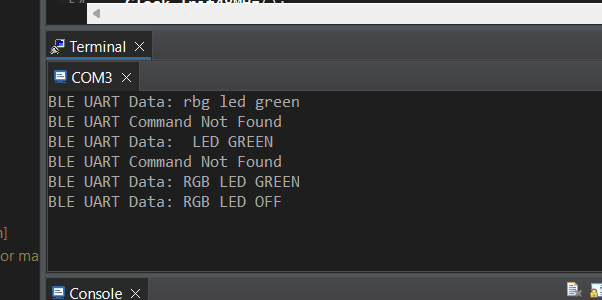

# ECE 528/L - Lab 4: Wireless Control

**California State University, Northridge**  

**Department of Electrical and Computer Engineering**  

**Authors:** Aolany Acosta and Hernan Zapien Robles

## Overview

This project uses the MSP432P401R microcontroller and the Adafruit Bluefruit LE UART Friend to control a TI-RSLK MAX robot through Bluetooth Low Energy. The BLE module communicates with the MSP432 through the EUSCI_A3 UART peripheral.

The completed software includes:
- A 9600-baud BLE UART driver
- BLE command processing for the MSP432 RGB LED
- Fixed-byte UART oscilloscope testing
- PMOD SWT-controlled UART transmission
- Bluefruit Controller packet reception
- Forward, backward, left, right, and stop motor commands

## Required Hardware
- TI MSP432P401R LaunchPad
- TI-RSLK MAX chassis
- Adafruit Bluefruit LE UART Friend
- PMOD SWT
- Oscilloscope and probe
- USB-A to Micro-USB cable
- Jumper wires
- Six AA batteries

## BLE UART Connections
| Adafruit BLE UART Pin | MSP432 Connection |
|---|---|
| MOD | P1.6 |
| CTS | GND |
| TXO | P9.6 / UCA3RXD |
| RXI | P9.7 / UCA3TXD |
| VIN | 3.3 V |
| RTS | Not connected |
| GND | GND |
| DFU | Not connected |

# Pre-Lab Assignment

## 1. Bluetooth Low Energy

Bluetooth Low Energy, or BLE, is a wireless communication technology designed for short, intermittent exchanges of data with low energy consumption. BLE devices can remain inactive for long periods and wake only when they need to advertise, connect, or transfer data.

Classic Bluetooth was designed for applications that may require continuous data transfer, such as audio streaming. BLE generally consumes less power because it uses shorter packets, brief connection events, and low-duty-cycle operation. Range is not determined only by whether a device uses BLE or Classic Bluetooth. It also depends on transmitter power, receiver sensitivity, antenna design, the selected BLE physical layer, and the surrounding environment. BLE can provide a range comparable to or greater than Classic Bluetooth when configured with an appropriate PHY.

## 2. GAP, Central, and Peripheral Devices

GAP stands for **Generic Access Profile**. GAP defines how BLE devices advertise, become discoverable, establish connections, and use device roles.

A **Peripheral** normally advertises its presence and accepts a connection. In this lab, the Adafruit Bluefruit module operates as the Peripheral.

A **Central** scans for advertising devices and initiates the connection. In this lab, the phone running the Bluefruit Connect application operates as the Central.

## 3. GATT, Profiles, Services, and Characteristics

GATT stands for **Generic Attribute Profile**. It defines how two connected BLE devices organize and exchange data using the Attribute Protocol.
- A **Profile** is a defined collection of services used together for a particular application.
- A **Service** groups related device functionality and contains one or more characteristics.
- A **Characteristic** represents an individual data value or control point. It may support operations such as read, write, notify, or indicate.

The phone normally acts as the GATT client, while the BLE peripheral holds the services and characteristics as the GATT server.

## 4. BLE Advertising Packets

An advertising packet is a message periodically transmitted by a BLE device before a connection is established. It allows nearby Central devices to discover the Peripheral.

Depending on the advertising configuration, the packet can contain information such as:
- Device name
- Device address
- Discoverability flags
- Supported service UUIDs
- Manufacturer-specific data
- Service data
- Transmit-power information
- Appearance or device type

Advertising packets allow a Central to identify a device and decide whether to establish a connection.

## 5. UUIDs

UUID stands for **Universally Unique Identifier**. BLE uses UUIDs to identify profiles, services, characteristics, and descriptors.

The Bluetooth SIG assigns shorter 16-bit UUIDs to standardized Bluetooth functions. Custom services and characteristics normally use 128-bit UUIDs. The larger identifier space makes it extremely unlikely that two independently created custom functions will accidentally use the same identifier.

## 6. UART Bit Order

The `UCMSB` bit, which is Bit 13 of the `UCAxCTLW0` register, determines the UART transmission and reception bit order.
- `UCMSB = 0`: least-significant bit first
- `UCMSB = 1`: most-significant bit first

This lab clears `UCMSB`, so the UART data is transmitted and received LSB first.

## 7. Default Port-Mapping Functions
| Pin | Mnemonic | Input Pin Primary Function | Output Pin Primary Function |
|---|---|---|---|
| P2.2 | PM_UCA1RXD / PM_UCA1SOMI | EUSCI_A1 UART RXD / SPI slave-out master-in | None for UART RXD; direction controlled by EUSCI for SPI |
| P2.3 | PM_UCA1TXD / PM_UCA1SIMO | None for UART TXD; direction controlled by EUSCI for SPI | EUSCI_A1 UART TXD / SPI slave-in master-out |
| P3.2 | PM_UCA2RXD / PM_UCA2SOMI | EUSCI_A2 UART RXD / SPI slave-out master-in | None for UART RXD; direction controlled by EUSCI for SPI |
| P3.3 | PM_UCA2TXD / PM_UCA2SIMO | None for UART TXD; direction controlled by EUSCI for SPI | EUSCI_A2 UART TXD / SPI slave-in master-out |

## 8. P2.2 and P2.3 Initialization

```c

void P2_2_and_P2_3_Init(void)

{

&#x20;   // Select the primary module function for P2.2 and P2.3

&#x20;   P2->SEL0 |= 0x0C;

&#x20;   P2->SEL1 \&= \~0x0C;

}

```

# UART Verification

## Fixed Bytes

The fixed-byte test transmits the following values through P9.7:
| Hexadecimal Byte | Binary Value | UART Data Order, D0 to D7 |
|---|---|---|
| 0xAA | 1010_1010 | 0 1 0 1 0 1 0 1 |
| 0x55 | 0101_0101 | 1 0 1 0 1 0 1 0 |
| 0xFF | 1111_1111 | 1 1 1 1 1 1 1 1 |
| 0x00 | 0000_0000 | 0 0 0 0 0 0 0 0 |

At 9600 baud, the expected duration of one UART bit is:

```text

Bit period = 1 / 9600 = 104.17 microseconds

```

Each UART frame contains one start bit, eight data bits transmitted LSB first, and one stop bit.

## PMOD SWT Byte Selection
| Active Switch | Byte Transmitted |
|---|---|
| SW1 only | 0xAA |
| SW2 only | 0x10 |
| SW3 only | 0xF0 |
| SW4 only | 0x0F |
| Any other combination | 0x00 |

The PMOD SWT inputs use P10.0 through P10.3 with internal pull-down resistors enabled.

# BLE Controller Motor Control

The Bluefruit Controller sends a five-byte Button packet:
| Byte | Purpose |
|---:|---|
| 0 | Header: `!` |
| 1 | Packet type: `B` |
| 2 | Button number |
| 3 | Button state |
| 4 | Checksum |

The motor controller uses the following commands:
| Arrow Button | Pressed Action | Released Action |
|---|---|---|
| Up (`5`) | Move forward | Stop |
| Down (`6`) | Move backward | Stop |
| Left (`7`) | Rotate left | Stop |
| Right (`8`) | Rotate right | Stop |

The program reads all five bytes, including the checksum byte, so the checksum cannot be mistaken for the beginning of the next packet. Releasing any directional button immediately calls `Motor_Stop()`.

# Screenshots

## BLE UART Terminal Output

The terminal output below shows valid and invalid BLE UART commands received from the Bluefruit Connect application.



# Verification Status

## Completed
- BLE UART driver implemented
- Project builds successfully in Code Composer Studio
- BLE UART command processing implemented
- Fixed-byte UART test implemented
- PMOD switch UART test implemented
- Bluefruit five-byte packet reader implemented
- Arrow-button motor decoder implemented
- Stop-on-release behavior implemented

## Pending Hardware Verification
- Capture and label the four fixed-byte oscilloscope waveforms
- Capture the five PMOD SWT-selected waveforms
- Verify all four motor directions on the physical robot
- Verify immediate stopping when each arrow is released
- Demonstrate all required tasks to the instructor

# Author Contributions
- **Aolany Acosta:** BLE UART implementation, CCS project integration, code testing, documentation, repository organization, and GitHub submission.
- **Hernan Zapien Robles:** Assisted with hardware setup, BLE communication testing, motor-control testing, oscilloscope verification, and review of the completed project.
- Both partners contributed to debugging and verification of the final system.

# References

1\. ECE 528/L, *Lab 4: Wireless Control*, California State University, Northridge, Fall 2026.

2\. Bluetooth SIG, *Bluetooth Core Specification - Generic Access Profile*. https://www.bluetooth.com/specifications/specs/

3\. Adafruit, *Introduction to Bluetooth Low Energy*. https://learn.adafruit.com/introduction-to-bluetooth-low-energy

4\. Adafruit, *Bluefruit LE Connect Controller*. https://learn.adafruit.com/bluefruit-le-connect/controller

5\. Texas Instruments, *MSP432P401R Mixed-Signal Microcontrollers Datasheet*. https://www.ti.com/lit/ds/slas826

6\. Texas Instruments, *MSP432P4xx SimpleLink Microcontrollers Technical Reference Manual*. https://www.ti.com/lit/ug/slau356

